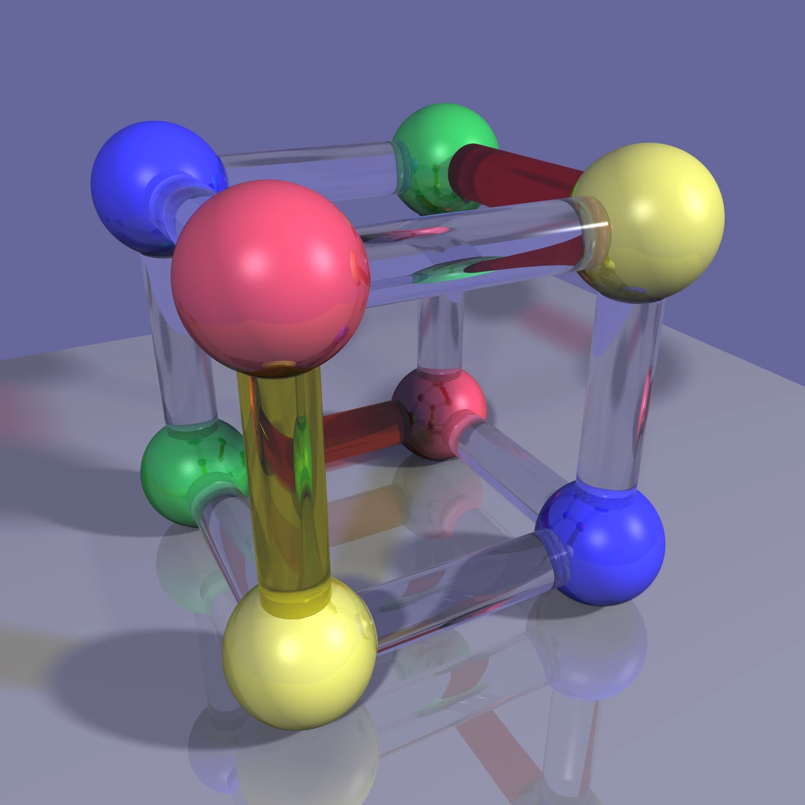
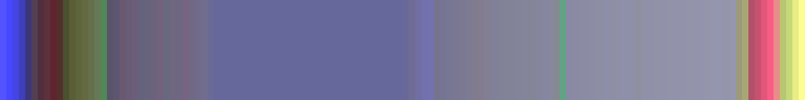
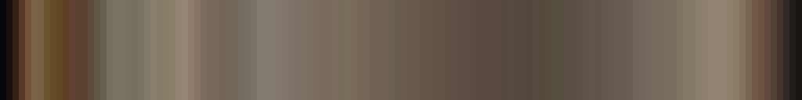
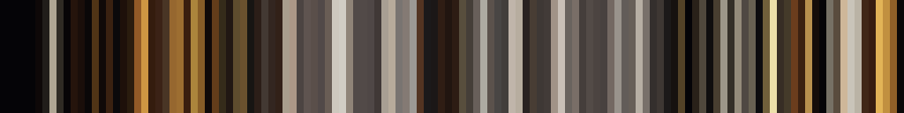
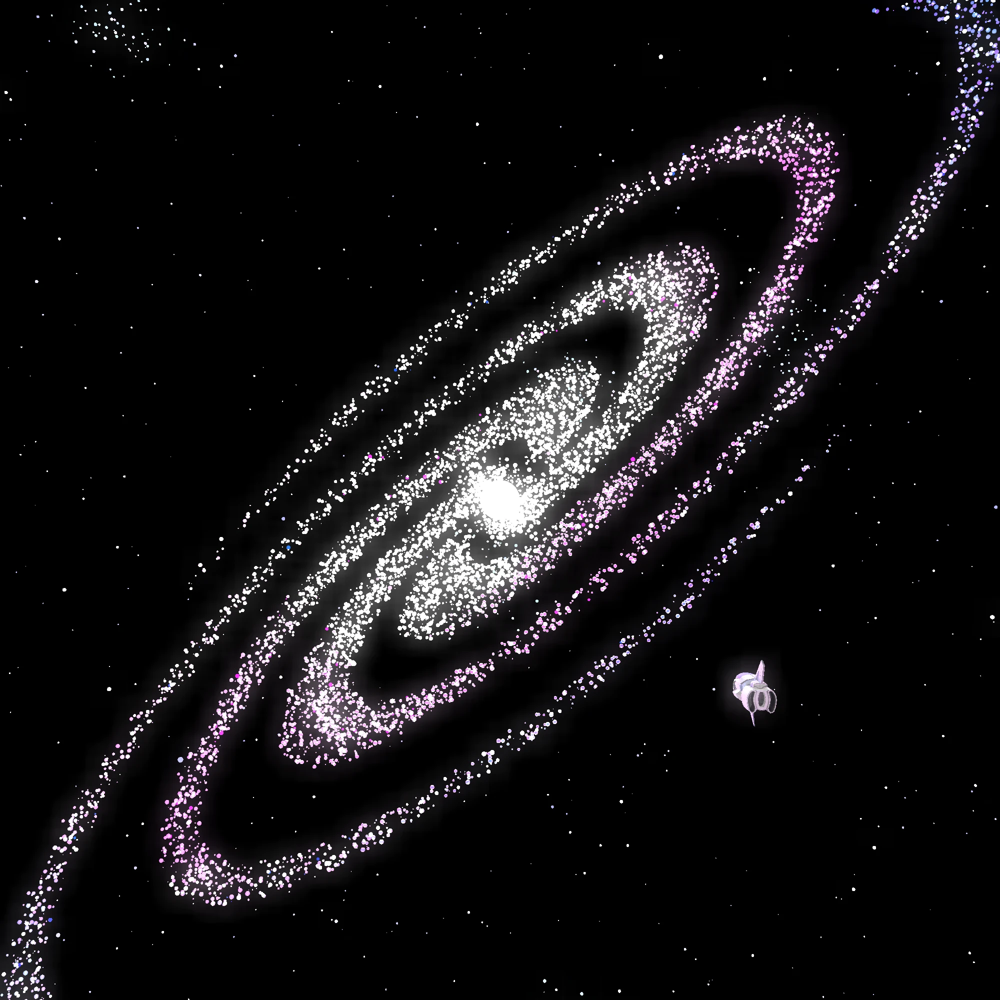
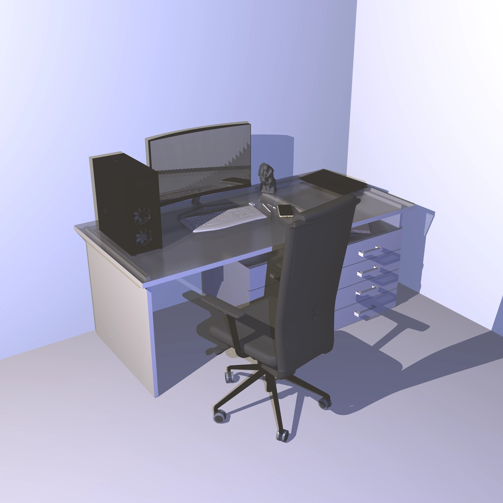
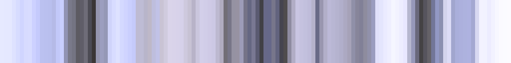
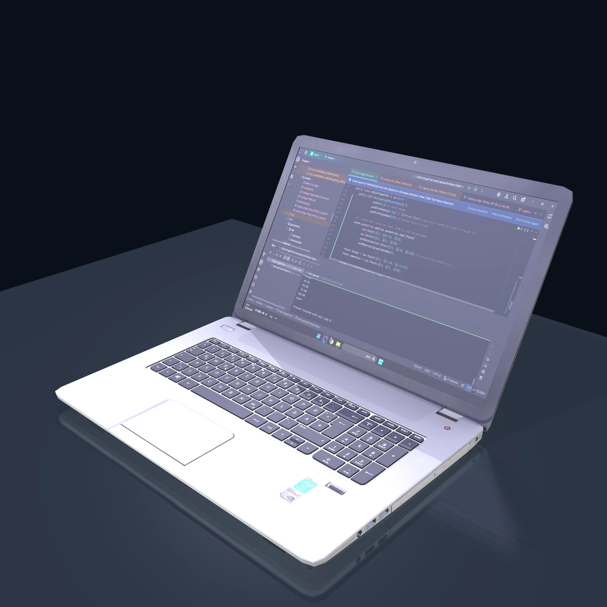

# Palette Atlas

Turn any image into a strip of color, and find paintings with a similar color scheme.


A static site with no server, in three parts:

- **Studio**: drop in an image, pick a path through it and get its strip. Point at the strip to see where each stripe came from, and save it as a poster or a phone wallpaper.
- **Atlas** (coming): a gallery of public-domain paintings with their strips, a "career barcode" for each artist, and search by color scheme.
- **Lab** (coming): an interactive explanation of the HNSW index behind the search.

Your images never leave your computer.

> Status: v0.1, the Studio. **Try it: [palette-atlas.pages.dev](https://palette-atlas.pages.dev)**

## How a strip is read

Each ray-traced render below becomes a strip of 128 colors, read four ways (top to bottom): left to right, from the center out, along a Hilbert curve, and by color. Every segment is the average of its pixels' light, the color they blend into from a distance.

<table>
<tr>
<td></td>
<td><br><br><br></td>
</tr>
<tr>
<td></td>
<td><br><br><br></td>
</tr>
<tr>
<td></td>
<td><br><br><br></td>
</tr>
<tr>
<td></td>
<td><br><br><br></td>
</tr>
<tr>
<td></td>
<td><br><br><br></td>
</tr>
<tr>
<td></td>
<td><br><br><br></td>
</tr>
</table>

## Credits

The sample paintings are in the public domain: the Mona Lisa (Louvre) by way of Wikimedia Commons, and A Sunday on La Grande Jatte, The Bedroom and The Great Wave courtesy of the Art Institute of Chicago (CC0).

## Development

Requires Node.js 24+ and pnpm.

```bash
pnpm install
pnpm --filter @palette-atlas/app exec playwright install chromium   # once, for the UI tests
pnpm build
pnpm test
```
