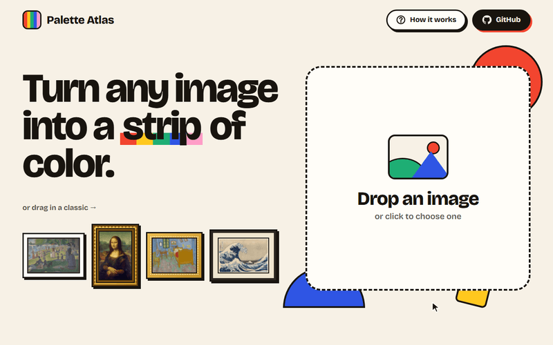
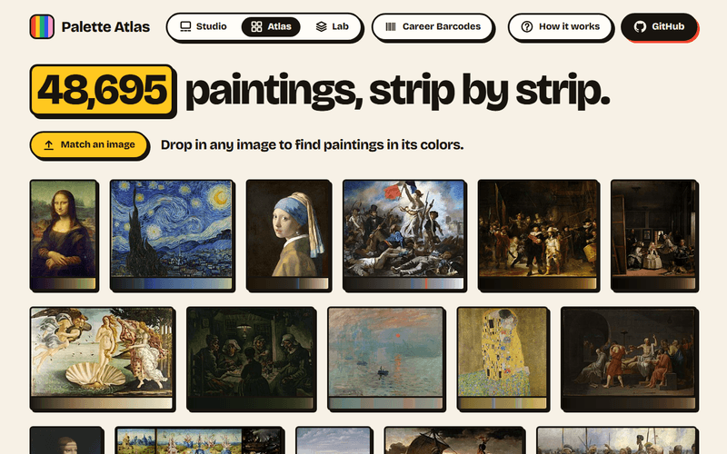
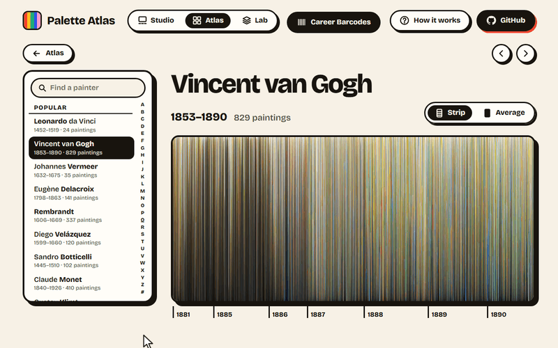
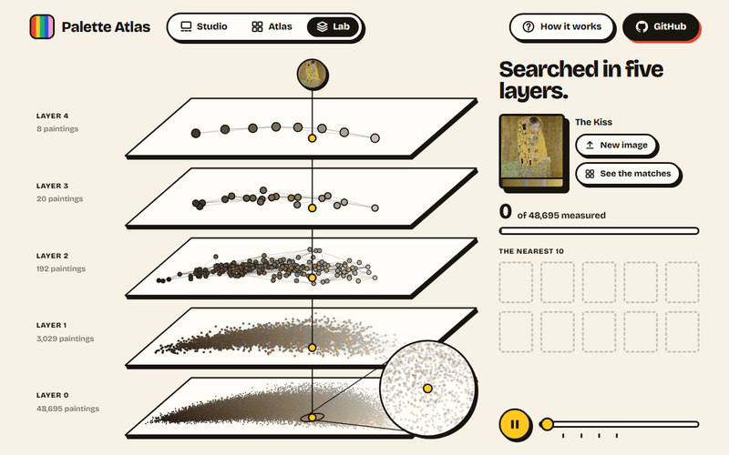

# Palette Atlas

Turn any image into a strip of color, and find the paintings painted in its colors.

**[Open Palette Atlas →](https://itzik123.github.io/PaletteAtlas/)**

A static site with no server: every image is read in your browser and never leaves your computer.

## Studio



Drop in any image, or drag in one of the classics, and choose a path through it: by color, along a Hilbert curve, column by column or from the center out. Point at a stripe to light up the pixels it came from, or at the picture to find its stripe, and save the strip as a poster or a phone wallpaper.

## Atlas



48,695 public-domain paintings, each over its color strip. Drop in any image and the Atlas hangs the 600 paintings nearest its colors, nearest first. Every painting has a page of its own, with its strips, the paintings in the same colors, and the picture enlarged in a museum frame.

### Career Barcodes



The careers of 8,373 painters, each painting a bar in its colors, oldest first. Van Gogh's turns from the browns of Nuenen to the blues and yellows of Arles.

## Lab



How the Atlas finds 600 paintings in about a millisecond: the very search it ran, replayed down the five layers of its index, every painting a dot of its own color. The search measures about 2,600 of the 48,695 paintings, and the Lab checks the 10 nearest it found against measuring every one.

## How it works

**A strip** is an image's pixels in 128 equal shares, each share's light averaged. The image is first shrunk to 256 px, averaging in linear light (as a canvas doesn't, so colors don't come out dark and muddy). A palette of 8 to 16 colors is found by k-means in OKLab, a space where distances match what the eye sees, and grows until it covers even a small accent. Its order is solved exactly, as a traveling salesman tour (Held-Karp), so the color strip runs smoothly from color to color. The Hilbert path uses a generalized curve that fills any rectangle, and every stripe remembers its pixels, which is how pointing at it lights them up.

**The search** compares color schemes, not layouts. Each painting's color strip becomes 128 numbers, a sliced Wasserstein embedding: its colors projected onto 8 directions, sorted and averaged in 16 shares. Two such vectors' mean absolute difference is the Earth Mover's Distance along each direction, the classic measure of how alike two color schemes look, at a fraction of its cost. The paintings' vectors sit in an HNSW index written from scratch for this project, with the most typical painting of each color family on its top layer. Quantized to a byte a number, it downloads once as 5.4 MB, and a Web Worker answers each search in about a millisecond, finding 98% of the true 10 nearest. Measurements and sources are in [docs/search-research.md](docs/search-research.md).

**The Lab** doesn't simulate the search. The index reports every step a search takes to a tracer, which the Atlas's searches leave silent, and the Lab records one and replays it. The dots lie on the map of the paintings' two main directions of difference (principal components, 92.5% of the variance), lighter to the right, warmer to the front.

**There is no server.** The libraries that read strips and build the index run both in the offline pipeline, which prepared the gallery, and in your browser, which reads your image the same way, in Web Workers so the page never freezes. The site is static files on a free host. Every page can be used by keyboard and passes axe-core's WCAG 2.2 AA checks, on laptops and phones.

## Project layout

TypeScript throughout, with no UI framework; Python only to download the paintings.

| Folder | What it holds |
|---|---|
| `packages/color` | sRGB, linear light and OKLab; k-means; palette ordering (Held-Karp) |
| `packages/strip` | The four paths through an image, and each stripe's source pixels |
| `packages/vectorize` | Color strip to search vector (sliced Wasserstein) |
| `packages/hnsw` | The HNSW index and brute force, the search trace, binary files |
| `packages/gallery` | The gallery's data format, written by the pipeline and read by the site |
| `pipeline/fetch` | Python: the catalog from Wikidata, licenses from Commons, polite downloads |
| `pipeline/build` | Node: the gallery's strips, careers and search index, written to `app/public/data` |
| `app` | The site: Studio, Atlas and Lab, with its Playwright tests in `app/e2e` |
| `benchmark` | Ray-traced renders, the standard images for visual checks, and their reference strips |

## Data and credits

The paintings are catalogued by [Wikidata](https://www.wikidata.org) (queried through [QLever](https://qlever.dev/wikidata)), and their images come from [Wikimedia Commons](https://commons.wikimedia.org), only files Commons marks public domain or CC0. The site loads each picture straight from Commons, and each painting's page credits its artist, title, date and collection.

The Studio's samples are in the public domain: the Mona Lisa (Louvre) by way of Wikimedia Commons, and A Sunday on La Grande Jatte, The Bedroom and The Great Wave courtesy of the [Art Institute of Chicago](https://www.artic.edu/open-access/open-access-images) (CC0).

The type is [Bricolage Grotesque](https://fonts.google.com/specimen/Bricolage+Grotesque) (SIL Open Font License), served from the site itself through Fontsource.

## Development

Requires Node.js 24+ and pnpm (the version is pinned in `package.json`).

```bash
pnpm install
pnpm --filter @palette-atlas/app exec playwright install chromium   # once, for the UI tests
pnpm dev         # the site at http://localhost:5173
pnpm test        # unit, integration and UI tests
pnpm typecheck
pnpm build
```

The gallery's data is in the repository, so none of this needs a download. To build it again from scratch (Python 3.14, standard library only):

```bash
python pipeline/fetch/fetch.py catalog   # choose the paintings on Wikidata and Commons (about 30 minutes)
python pipeline/fetch/fetch.py images    # download them to pipeline/data (hours; rerun to resume)
pnpm paintings                           # read their strips and write the site's data
```

## License

The code is under the [MIT License](LICENSE). The ray-traced renders in `benchmark/` and the GIFs in `docs/` are under [CC BY 4.0](https://creativecommons.org/licenses/by/4.0/); the paintings shown in them are in the public domain.
